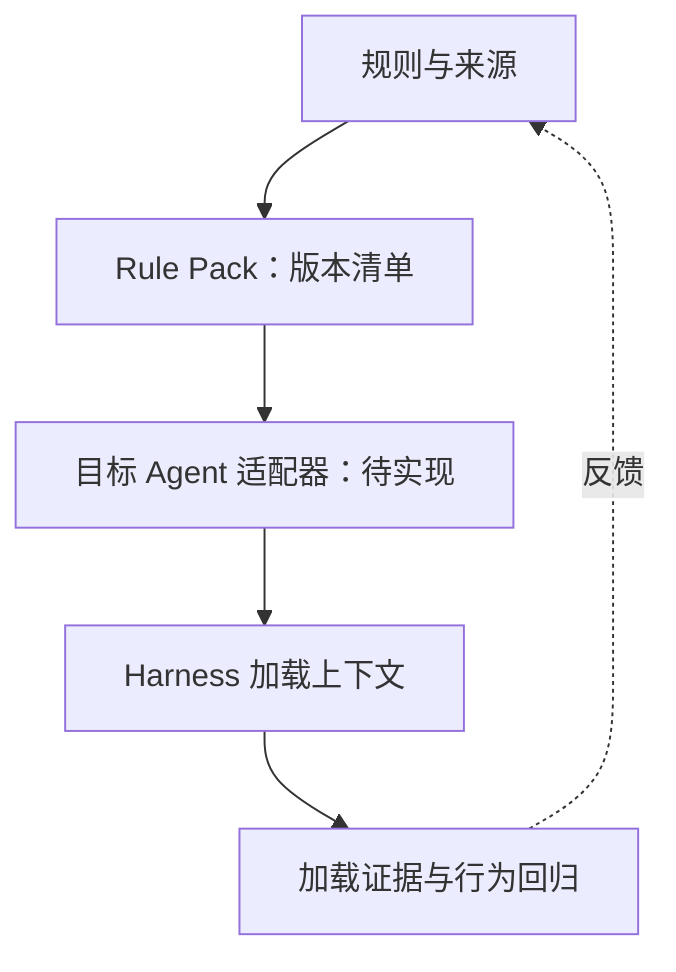

# 规则资产架构

2026-11-02；设计契约，适配器尚未实现。

可解释：交代原因、反例、权衡；自描述：让人和 Agent 判断适用范围与使用条件。以下是本仓契约，不是跨 Agent 通用 frontmatter 标准。

| 字段 | 必需内容 |
|---|---|
| identity | 稳定 ID、名称、维护者 |
| intent/rationale | 问题、理由、反例、取舍 |
| scope | 路径/任务、排除条件、命中与不命中样例 |
| dependencies | 资产 ID、版本、冲突；无依赖写 none |
| compatibility | 产品版本、加载方式、验证状态 |
| evidence | 命令、结果、日期、正反例与未执行原因 |
| provenance | 公开来源、权属、许可证、脱敏审核 |
| version | 版本、变更原因、迁移与回退 |

Rule Pack 固定规则 ID、版本、源 SHA、排除项与冲突决议。破坏性变化升 major、兼容新增升 minor、文字修正升 patch。现有元规则尚未迁移，不能声称全库具备统一元数据。

适配器负责发现、筛选、转换、注入、留证。目标字段必须转换成产品原生格式；不能假定额外 YAML 自动生效。不能保持作用域时应拒绝静默变成全局规则。安装展示 diff，不覆盖用户文件；卸载只撤销自身内容并检查用户后续修改。

DSH 可考虑显式生成适用的 AGENTS.md，或遵循 Cordis 生命周期提供运行时插件；均未实现。纯文档资产包不必每条开发代码插件。规则版本、适配器版本、Agent 版本分别记录。

来源核对、静态结构、真实加载、行为回归分层记录 PASS/FAIL/NOT_RUN。运行时覆盖命中、范围外、冲突、配置缺失；固定模型与各资产 SHA，保留重复试验和失败案例，另外验证卸载与回退。一次遵守不能证明稳定服从。
