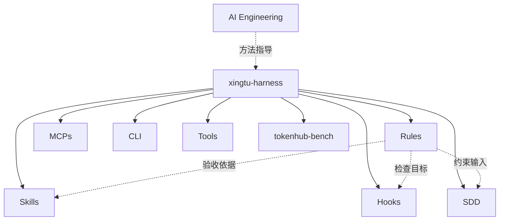

# 开源矩阵与组合

2026-11-02 只读核对各仓 README 以及 Harness 四个入口文件。资产聚合指 Git submodule 固定引用；逻辑协作指方法与约束互相使用；运行时依赖指必须存在的加载器、服务和配置。三者不能互换。

实线仅表示当前子模块聚合；虚线为建议逻辑协作，不代表代码依赖或自动联动。各节点对应 `xingtu1996` 同名仓库（Rules 等为 `xingtu-` 前缀）。

| 仓库 | 价值 | Rules 协作与缺口 |
|---|---|---|
| xingtu-ai-engineering | 方法论与治理模板 | 将原则映射到可测规则，映射尚未落实 |
| xingtu-harness | 子模块与场景清单 | 缺 Agent 激活、适配及加载证据 |
| xingtu-rules | 工程约束 | 缺丰富规范样例、统一元数据迁移 |
| xingtu-skills | 任务方法 | 缺规则 ID/版本依赖契约 |
| xingtu-hooks | 工具事件检查 | 缺规则到检查器映射；README 声明 fail-open，非完整安全边界 |
| xingtu-sdd | 任务规格与验收 | 可引用规则，不自动继承 |
| xingtu-mcps | 服务化工具资产 | 服务注册、协议和真实调用需逐项验证 |
| xingtu-cli | 终端能力与封装 | 需显式环境与权限配置 |
| xingtu-tools | 工程工具聚合 | 与 CLI 镜像关系不可误作独立权威源 |
| tokenhub-bench | 模型任务评测 | 不证明 Rules 加载或遵守，需专门规则回归 |

[.gitmodules](https://github.com/xingtu1996/xingtu-harness/blob/main/.gitmodules) 声明 8 个 SSH 子模块；[marketplace.json](https://github.com/xingtu1996/xingtu-harness/blob/main/marketplace.json) 版本 0.1.0 声明 7 场景。[install.sh](https://github.com/xingtu1996/xingtu-harness/blob/main/install.sh) 只拉取并检查 README；[harness](https://github.com/xingtu1996/xingtu-harness/blob/main/harness) install 只拉取所选模块。SSH 拉取要求凭据，不能把 HTTPS 克隆父仓视作匿名递归成功。其他仓本轮不改。

| 当前场景 ID | 实际拉取模块 |
|---|---|
| presale | SDD、Skills |
| admin | Rules、Skills |
| coding-0to1 | Skills、Hooks、SDD |
| coding-1ton | Skills、Hooks、Rules |
| monolith | Skills、CLI |
| microservice | Skills、Rules、MCPs |
| finance | Rules、SDD |

| 推荐使用场景 | 建议组合 | 尚需用户项目完成 |
|---|---|---|
| Java 后端 | Rules + Skills + Hooks | 选择规范、注册检查、实测 |
| Vue/React 前端 | Rules + Skills | 转换路径语义、验证范围外不加载 |
| 微服务交付 | Rules + SDD + Skills + MCPs | 固定规格、服务配置与依赖版本 |
| 安全审查 | Rules + Hooks + Tools | 故障与绕过测试，确认 fail-open |
| 多 Agent | Harness + Rules + Skills + SDD | 隔离任务、冲突对账、锁定版本 |

推荐组合是设计建议，全部集成运行时测试 NOT_RUN。Rules 的独立价值是复用规范，当前矩阵差距是缺少从规则身份到安装、加载、检查、回退的可验证链路。
