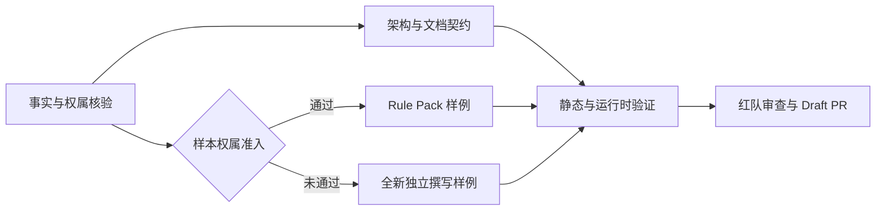

# XRULE-001 Options｜架构、工作包与任务归属

## 架构候选

| 方案 | 内容 | 优点 | 代价/风险 | 结论 |
|---|---|---|---|---|
| A. 扁平 Markdown 规则库 | 规则文档加少量索引 | 最简单、已有路径可复用 | 来源、作用域、兼容和验证难统一检索 | 可作底层文件，不足以单独达成目标 |
| B. Rule Pack + Adapter 契约 | Pack 是规则、元数据、测试与来源证据；Adapter 是按平台实现的发现/加载/过滤/记录机制 | 区分纯资产与运行时能力，可组合、可版本化、可逐平台测试 | 需先定义最小字段和状态词汇 | 推荐；先做静态契约和一个适配验证，不造平台 |
| C. 全功能插件/注册中心 | 依赖解析、自动发现、跨平台注入和审计服务 | 长期可扩展 | 依赖运行时开发、扩大攻击面与维护成本，当前无证据证明需要 | 不纳入本轮 |

## 概念边界

- 项目指令（`AGENTS.md`/`CLAUDE.md` 等）：项目入口、环境和工作约定；具体读取方式由平台决定。
- Rule：有适用条件的工程约束；可能仅供人/模型阅读，是否加载取决于平台/适配器。
- Skill：按需完成任务的方法与步骤，可引用 Rule 作为验收依据。
- Hook：接入工具生命周期的程序化检查；只在实际配置并触发时生效。
- SDD：单次变更的目标、边界、决策和验收证据。
- Harness：组织、安装和交付若干资产的工作环境/组合层；链接或子模块不自动等于激活。

逻辑关系不是固定执行顺序。必须分别记录：获取/克隆 → 安装/链接 → 运行时发现/加载 → 模型遵守 → 工具强制检查。后一步不可由前一步推定。

## 建议的 Pack 元数据最小字段

`id`, `name`, `version`, `kind`, `intent`, `rationale`, `scope.include`, `scope.exclude`, `dependencies`, `conflicts`, `compatibility[]`（平台、能力、产品版本、状态、官方来源、核验日期、限制）, `verification`（正例、反例、步骤、结果）, `provenance`（来源类别、作者/许可状态、发布审查状态）。

本字段表是 XRULE 提案，不声称是任一平台原生格式。状态至少区分 `SUPPORTED`（文档说明支持）、`TESTED`（XRULE 有实测证据）、`EXPERIMENTAL`、`UNSUPPORTED`、`NOT_TESTED`；状态对象必须带日期和证据。

## 工作包归属（与 task-contract 对齐）

| WP | Owner | 输入 | 输出 | 依赖 | 验收证据 |
|---|---|---|---|---|---|
| WP0 事实/来源 | 主会话 PM；只读调查可并行 | 仓库/官方文档/论文/源规则目录 | 可追溯事实表、权属候选表、Harness 安装链证据 | 无 | 每项有来源、日期、状态；未知明确标出 |
| WP1 架构/文档 | 主会话整合；文档作者独占 README/SELF 后续改稿 | WP0 | 契约、边界说明、关系图、README/SELF 补丁 | WP0 | 事实边与建议边分离，链接可验证 |
| WP2 样例 | 单一规则作者 | WP0 权属准入 | 一条独立规则与正反例 | G3 准入 | 来源许可可证明，或明确为全新独立创作 |
| WP3 测试/适配 | 与 WP2 不同的验证 Owner | WP2 | 静态检查与一个平台加载记录 | WP2 | 版本、步骤、观察结果、失败证据 |
| WP4 红队/交付 | 独立审查者；主会话 PM 收口 | WP1-WP3 | 对抗报告、隐私/事实核验、Draft PR | 前序完成 | 无高风险未处理项；禁止自动合并 |

## 依赖图（计划关系，不是既有实现）

此图仅表达 XRULE-001 的建议工作依赖，不表示 xingtu-harness 当前已有上述流水线。

## 反例 / 否决条件

- 仅文件放入特定目录就宣称全平台自动加载：拒绝。
- 把官方文档存在等同于 XRULE 适配已测试：拒绝。
- 脱敏后直接搬用内部规则且未确认权属：拒绝。
- 只检查元数据文件存在就称样例有效：拒绝。
- 把子模块克隆等同于 Skill/Rule 已注入模型：拒绝。
- 把 Rule 文本描述成安全沙箱或不可覆盖权限：拒绝。

## 取舍裁决

采用方案 B 的最小版本：先产出契约、来源证据和一个有权属准入的样例，再进行单平台实测。官方平台与研究索引可以分文档沉淀，但需要真实核验后才写具体支持结论。若平台测试环境或规则授权缺失，保留 `NOT_TESTED`/`UNKNOWN`，不伪造完成态。
